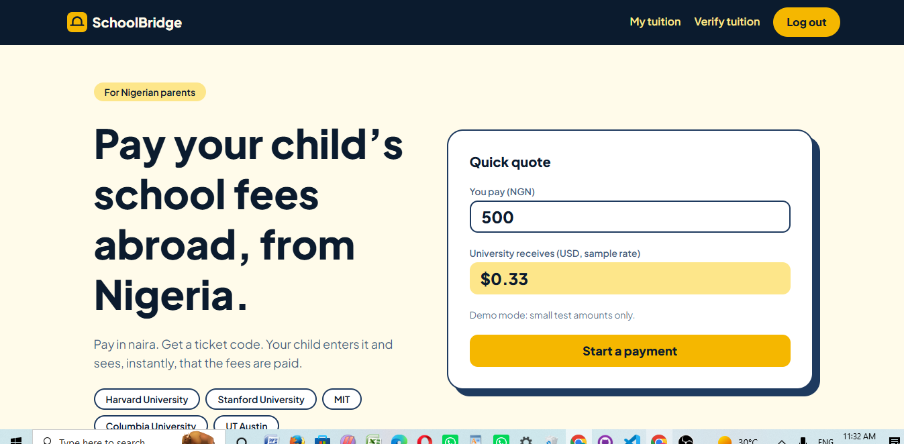
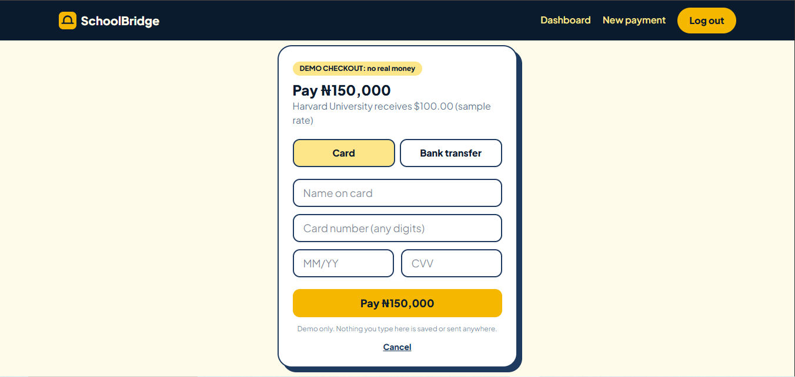
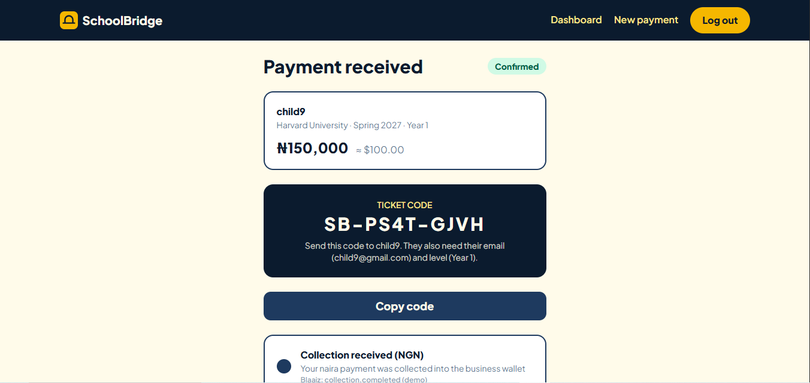
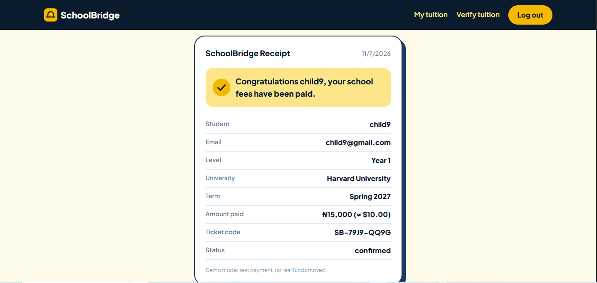

# SchoolBridge

**Pay your child's school fees abroad, from Nigeria.**
A parent pays in naira and gets a ticket code. The child verifies the code with their own account and receives a receipt.

**Live demo:** https://schoolbridge-vit.vercel.app
*(The server is on a free tier. The first request can take up to a minute to wake up.)*

Built for the **Blaaiz Buildathon** (GDG Ilorin x Blaaiz).

> **Demo mode.** Payments run through a clearly labelled mock provider with tiny amounts (e.g. ₦500 ≈ $0.33 at a sample rate of ₦1,500/$). No real money moves, and nothing typed on the checkout page is saved. Blaaiz sandbox access was not available in time, so the Blaaiz calls below are documented, not live.

## The problem

Nigerian parents paying for a child's tuition abroad deal with unclear rates, slow transfers, and no simple way for the child to confirm the fees were received. SchoolBridge makes that one clear flow.

## User journey

1. **Parent** signs up and starts a payment: child's name and email, level, university, term and amount, with a live quote.
2. Parent pays on a demo checkout (card or bank transfer) and gets a **ticket code** (`SB-XXXX-XXXX`).
3. A **status timeline** follows the payment: collection received, payout sent, confirmed by school.
4. **Student** signs in with their own account and verifies the ticket. The code and level must match, and the email must be the one the parent entered.
5. The student gets a **receipt** they can print or save as PDF.

Supported universities in demo mode: Harvard, Stanford, MIT, Columbia, UT Austin.

## Screenshots

| Landing | Demo checkout |
|---|---|
|  |  |

| Ticket and timeline | Student receipt |
|---|---|
|  |  |

## How Blaaiz would power it

All calls use OAuth client credentials against `https://api-dev.blaaiz.com` (sandbox).

| Step | Blaaiz API | In this demo |
|------|------------|--------------|
| Quote | Rate and Fees breakdown endpoints | Fixed sample rate |
| Parent pays in NGN | Initiate collection, with `merchant_reference` set to the ticket code. The NGN wallet is credited. | Demo checkout page |
| Pay the school in USD | Create payout (ACH or wire) from the business wallet, with `merchant_reference` set to the ticket code | Mock status change |
| Track status | `collection.completed` and `payout.completed` webhooks, verified with `x-blaaiz-signature`. Fallback: fetch the transaction by `merchant_reference`. | Mock lifecycle: paid, sent to school (3s), confirmed (7s) |

The payment logic lives behind a provider layer (`server/src/services/payments.ts`). A Blaaiz provider can replace the mock by setting `PAYMENT_PROVIDER=blaaiz`.

## Tech stack

- **Client:** Next.js 16 (App Router), TypeScript, Tailwind CSS v4
- **Server:** Node.js, Express, TypeScript
- **Database:** MongoDB Atlas (Mongoose)
- **Auth:** JWT in an httpOnly cookie, bcryptjs, rate limiting
- **Hosting:** Vercel (client), Render (server)

## Run locally

Requires Node.js 20+ and a MongoDB Atlas connection string.

**Server** (folder `server`):

```bash
cd server
npm install
```

Create `server/.env`:

```env
PORT=5000
MONGO_URI=your_mongodb_connection_string
JWT_SECRET=a_long_random_string
CLIENT_URL=http://localhost:3000
PAYMENT_PROVIDER=mock
```

```bash
npm run dev
```

**Client** (folder `client`):

```bash
cd client
npm install
```

Create `client/.env.local`:

```env
NEXT_PUBLIC_API_URL=http://localhost:5000
```

```bash
npm run dev
```

Open http://localhost:3000.

`.env` and `.env.local` are never committed.

## Project structure

```
client/   Next.js app (pages, components, API helper)
server/   Express API (routes, models, payment provider layer)
docs/     Screenshots
```

## Roadmap

- Live Blaaiz sandbox integration (collection, payout, webhooks)
- Real exchange rates and fee breakdown from Blaaiz
- Email notification to the student when a ticket is created
- More universities and currencies

## License

MIT. See [LICENSE](LICENSE).